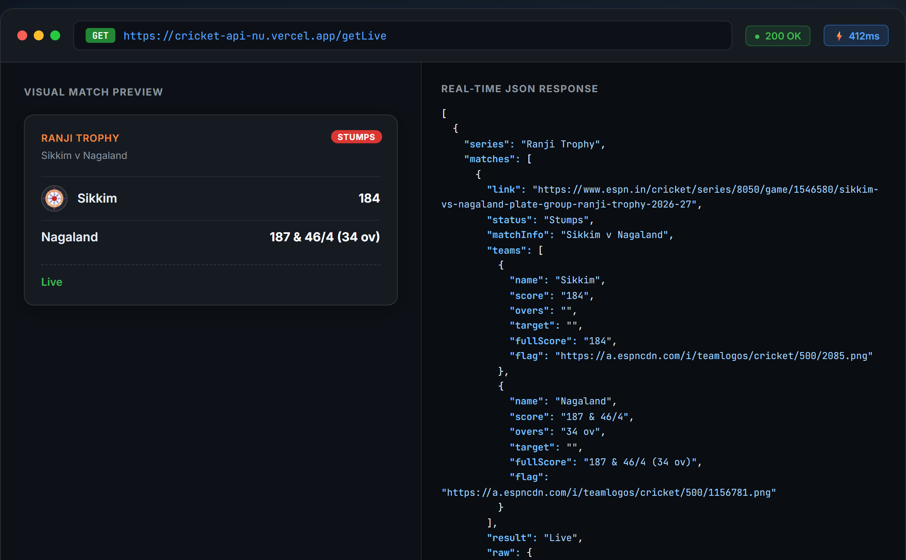
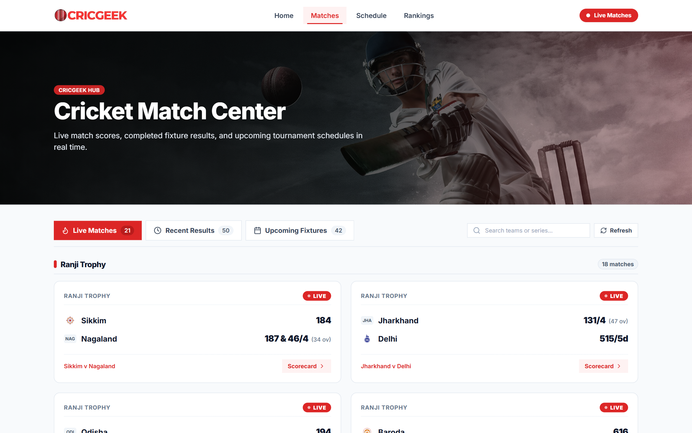
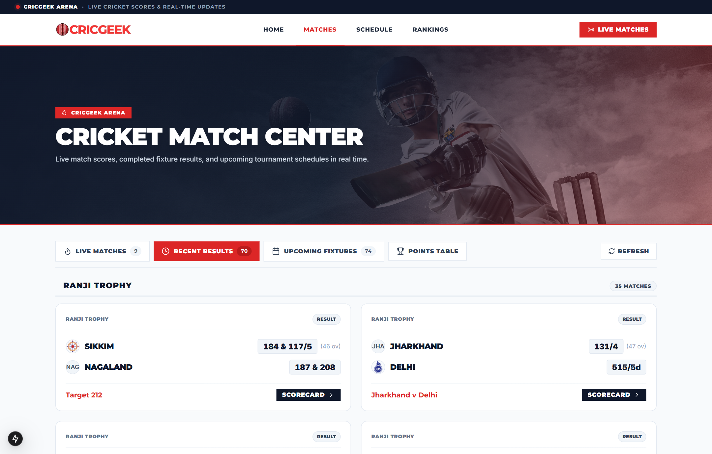
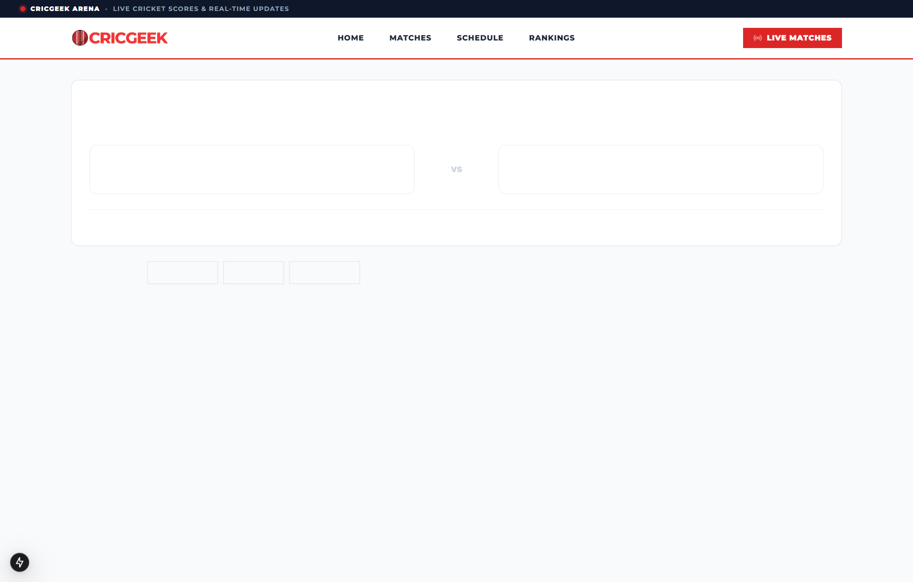
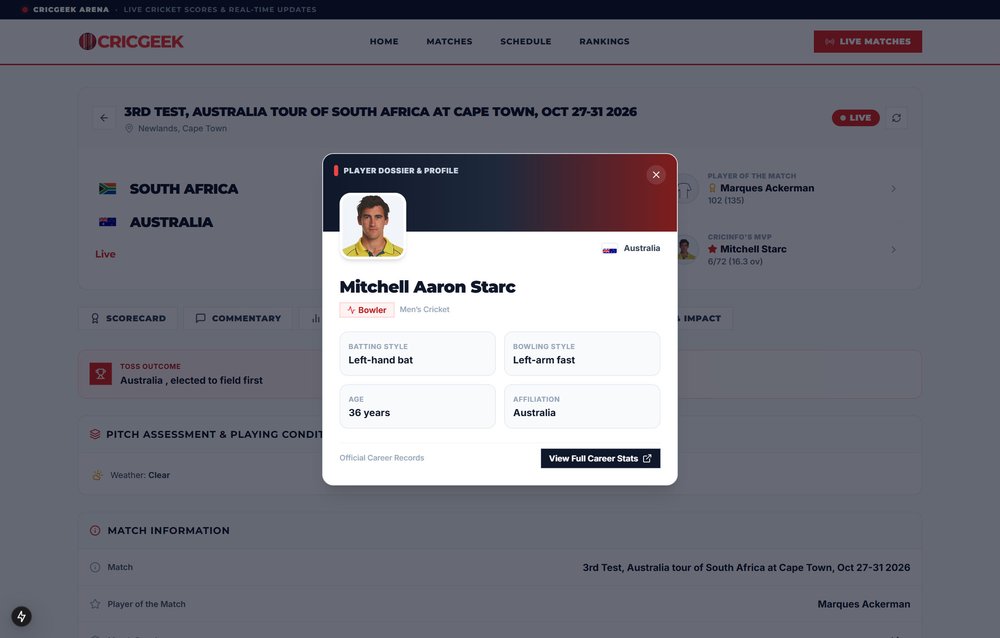
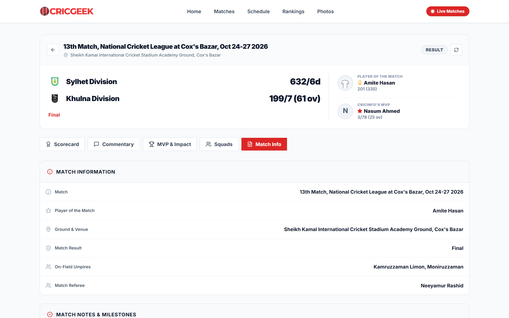
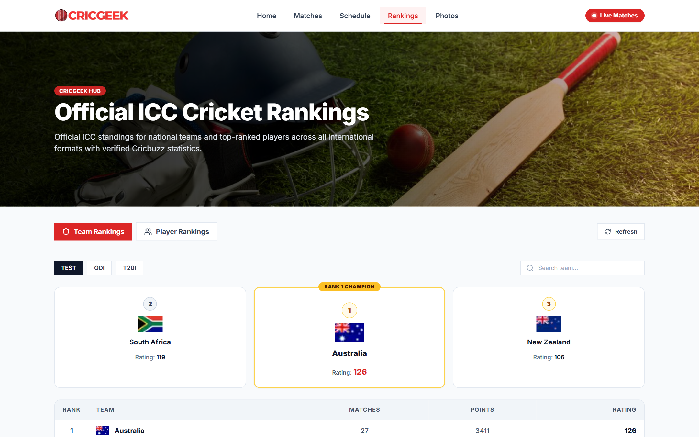

# Cricket API & Scraper 🏏

A high-performance, resilient REST API and web scraper for real-time cricket data, live match scores, fixtures, tournament schedules, Cricbuzz photo galleries, ICC rankings, ball-by-ball commentary, and detailed innings scorecards.



---

## 📱 Frontend Companion: CricGeek UI

This backend powers **[CricGeek](https://github.com/Abhip32/CricGeek)** — a luxury sports web platform inspired by athletic editorial styling (bold high-contrast typography, athletic crimson red `#DC2626` / pure white theme, freely-rendering flags, and zero auto-polling overhead).  
🌐 **Live Web Application**: [https://cric-geek.vercel.app](https://cric-geek.vercel.app)

### 📸 Application Views & Showcase

| Home Dashboard | Live Match Center | Completed Fixtures & Results |
|:---:|:---:|:---:|
|  |  |  |

| Innings Scorecard & Analytics | MVP & Player Impact Leaderboard | Ball-by-Ball Commentary & Over Timeline |
|:---:|:---:|:---:|
|  |  |  |

| Match Info & Playing XI | Tournament Schedule & Fixtures | Official ICC Leaderboards |
|:---:|:---:|:---:|
|  |  |  |

| Cricbuzz High-Res Photo Galleries | ICC Player Rankings | Upcoming Fixtures (ESPN Powered) |
|:---:|:---:|:---:|
|  |  |  |

---

## ⚡ Key Architecture & Recent Upgrades

1. **100% ESPN API-Powered Upcoming Matches (`/getUpcoming`)**:
   - Replaced fragile HTML table scrapers with direct integration into ESPN Cricinfo's official Header API (`fetchEspnUpcomingMatches`).
   - Guarantees complete, un-truncated coverage of all upcoming international and domestic matches with reliable timestamps and team details.

2. **Dedicated Tournament Schedule Endpoint (`/getSchedule`)**:
   - Completely separated tournament schedules and series calendars from daily upcoming match fixtures.
   - Parses detailed fixture matrices including match dates, tournament series titles, venue locations, and match formats.

3. **Cricbuzz Photo Galleries & Albums (`/getPhotos`)**:
   - Integrated Cricbuzz photo gallery scraper providing high-resolution cricket photography (`750x422`).
   - Supports album listings and individual gallery view queries (`?id=:albumId`) with photo titles, high-res image CDN links, and photo captions.

4. **Dynamic Team Flags & Lazy-Loading Solution (`flagService.js`)**:
   - Resolves ESPN Cricinfo's lazy-loaded SVG placeholders (`lazyimage-noaspect.svg`) in real time.
   - Learns and registers team flags dynamically from live matches, scorecards, rankings, and match cards.
   - Built-in resolution for 190+ country flags and club badges, with instant fallback matching.
   - Exposes `/team-flags` to query any flag by name or abbreviation (e.g. `?team=India` or `?team=NZ`).

5. **Ball-by-Ball Commentary Stream (`/getCommentary`)**:
   - Real-time commentary stream with bowler-to-batter matchup headlines, over summaries, ball outcomes (`W`, `4`, `6`, `1`, `0`), and narrative ball descriptions.

6. **Active Multi-Tier In-Memory Caching (`cacheService.js`)**:
   - High-performance LRU memory cache with endpoint-specific TTLs (45s for live scores, 10m for upcoming/news, 1h for rankings).
   - Cache hits respond in **< 5 milliseconds**.
   - Bypass cache anytime using `?refresh=true` or `?nocache=true`.

7. **Resilient Puppeteer & Serverless Chromium Engine (`browserService.js`)**:
   - Centralized browser management with auto-reconnection and resource cleanup.
   - Blocks heavy stylesheets, fonts, ads, and video streams to reduce scraping latency from 30s down to **1.5–2.5s**.

---

## 🚀 Getting Started

### 1. Install Dependencies
```bash
npm install
```

### 2. Start Server
```bash
# Production mode
npm start

# Development mode with nodemon live reload
npm run dev

# Re-generate documentation preview screenshot
npm run screenshot
```

The API will be available at `http://localhost:8000`.

---

## ☁️ Vercel Serverless Deployment

This project is optimized for deployment as a Vercel Serverless Function:
- **Serverless Chromium**: Automatically switches to [`@sparticuz/chromium-min`](https://github.com/Sparticuz/chromium) and `puppeteer-core` in serverless environments (`VERCEL=1`), fitting cleanly within Vercel's function zip limits without missing shared C++ libraries.
- **Local Fallback**: Automatically discovers local Chrome / Edge installations when running on local development machines.
- **Extended Timeout**: Configured with `maxDuration: 60` and `memory: 1024` in [`vercel.json`](vercel.json) to ensure headless browser launches and page parsing finish comfortably.

---

## 📖 API Documentation & Endpoints

### 1. Root & Documentation
- **Endpoint**: `GET /`
- **Description**: Returns live API status and an interactive catalog of all available endpoints and parameters.

### 2. Health Check
- **Endpoint**: `GET /health`
- **Description**: Lightweight health probe returning `{ status: 'ok', timestamp: '...' }` for uptime checkers.

### 3. Live Matches
- **Endpoint**: `GET /getLive`
- **Cache TTL**: 45 seconds
- **Parameters**: `refresh=true` *(optional)*
- **Response**: Array of current live matches with teams, scores, overs, run rates, targets, series, match status, and dynamic team flags.

### 4. Recent Matches
- **Endpoint**: `GET /getRecent`
- **Cache TTL**: 5 minutes
- **Parameters**: `refresh=true` *(optional)*
- **Response**: Completed matches grouped by series with final results, scores, and dynamic team flags.

### 5. Upcoming Matches & Fixtures
- **Endpoint**: `GET /getUpcoming`
- **Cache TTL**: 10 minutes
- **Source**: 100% powered by ESPN Cricinfo official API.
- **Parameters**: `refresh=true` *(optional)*
- **Response**: Upcoming fixtures with full team details, dynamic team flags, tournament series, start date/time, and match status.

### 6. Tournament Schedule & Fixtures Calendar
- **Endpoint**: `GET /getSchedule`
- **Alias**: `GET /getschdule`
- **Cache TTL**: 10 minutes
- **Parameters**: `refresh=true` *(optional)*
- **Response**: Comprehensive tournament schedules, series fixtures, venue information, and match timings across international and domestic cricket.

### 7. Cricbuzz Photo Galleries & Albums
- **Endpoint**: `GET /getPhotos`
- **Cache TTL**: 15 minutes
- **Parameters**:
  - `id` *(optional)*: Album ID (e.g. `?id=2405`) to fetch individual gallery images with captions and photo credits.
  - `refresh=true` *(optional)*
- **Response**: High-resolution cricket photo albums (`750x422`) with titles, cover images, image counts, and timestamps.

### 8. Full Match Scorecard
- **Endpoint**: `GET /getScoreCard` or `GET /getScorecard`
- **Cache TTL**: 45 seconds (live) / 30 minutes (completed)
- **Parameters**:
  - `url` *(optional)*: ESPN Cricinfo match URL. Defaults to the latest active match if omitted.
  - `refresh=true` *(optional)*
- **Response**: Detailed scorecard with batting tables (runs, balls, 4s, 6s, SR, dismissal), bowling tables (overs, maidens, runs, wickets, economy), fall of wickets, team totals, player headshots, and match status.

### 9. Ball-by-Ball Match Commentary
- **Endpoint**: `GET /getCommentary`
- **Cache TTL**: 30 seconds
- **Parameters**:
  - `url` *(required)*: ESPN Cricinfo match URL.
  - `refresh=true` *(optional)*
- **Response**: Ball-by-ball commentary entries with over numbers, ball outcomes (`W`, `4`, `6`, `1`, `0`), bowler and batter names, and narrative commentary text.

### 10. Cricket News
- **Endpoint**: `GET /getNews`
- **Cache TTL**: 10 minutes
- **Parameters**: `refresh=true` *(optional)*
- **Response**: Latest cricket news articles with titles, descriptions, authors, publication dates, images, and article links.

### 11. ICC Team Rankings
- **Endpoint**: `GET /rankings/icc-team-ranking` or `GET /getTeamRankings`
- **Cache TTL**: 1 hour
- **Response**: Men's and Women's ICC rankings for Test, ODI, and T20 teams with ratings, points, and dynamic logos.

### 12. ICC Player Rankings
- **Endpoint**: `GET /rankings/icc-player-ranking` or `GET /getBattingRankings`, `/getBowlingRankings`, `/getAllRounderRankings`
- **Cache TTL**: 1 hour
- **Response**: Official ICC player rankings across Batting, Bowling, and All-rounders in Test, ODI, and T20 formats with player names, ratings, and nationalities.

### 13. Dynamic Team Flags Directory
- **Endpoint**: `GET /team-flags`
- **Parameters**:
  - `team` *(optional)*: Query flag for a specific team (e.g. `?team=India` or `?team=NZ`).
- **Response**: Full dictionary of resolved team names and high-resolution flag CDN URLs.

---

## 📁 Project Structure

```
Cricket-Api/
├── assets/                       # High-resolution screenshots & preview assets
├── controller/
│   ├── MatchDataController.js    # Live, Recent, Upcoming (ESPN API), & Schedule
│   ├── newsController.js         # Cricket news extraction
│   ├── photoController.js        # Cricbuzz photo galleries & albums
│   ├── rankingController.js      # ICC team & player rankings
│   └── scoreCardController.js    # Full match scorecards & ball-by-ball commentary
├── routes/
│   ├── MatchDataRoute.js         # /getLive, /getRecent, /getUpcoming, /getSchedule
│   ├── newsRoute.js              # /getNews
│   ├── photoRoute.js             # /getPhotos
│   ├── rankingRoutes.js          # /rankings/*
│   └── ScoreCardRoute.js         # /getScorecard, /getCommentary
├── services/
│   ├── browserService.js         # Puppeteer lifecycle & ad/media blocker
│   ├── cacheService.js           # Multi-tier TTL cache with LRU eviction
│   └── flagService.js            # Dynamic team flag learning & resolution
├── scripts/
│   └── generate_screenshot.js    # Generates preview.png asset
├── index.js                      # Main Express server & API catalog
├── vercel.json                   # Serverless deployment configuration
└── package.json                  # Dependencies & scripts
```

---

## 👨‍💻 Author

Created & Maintained by **[Abhip32](https://github.com/Abhip32)**
