# Cricket API & Scraper 🏏

A high-performance, resilient REST API and web scraper for real-time cricket data, live match scores, fixtures, tournament schedules, points tables, player profiles, ball-by-ball commentary, match analytics (Partnerships, FOW, DRS, Manhattan, Worm), live ground weather, stadium profiles, chronological match milestones, Cricbuzz photo galleries, ICC rankings, and detailed innings scorecards.

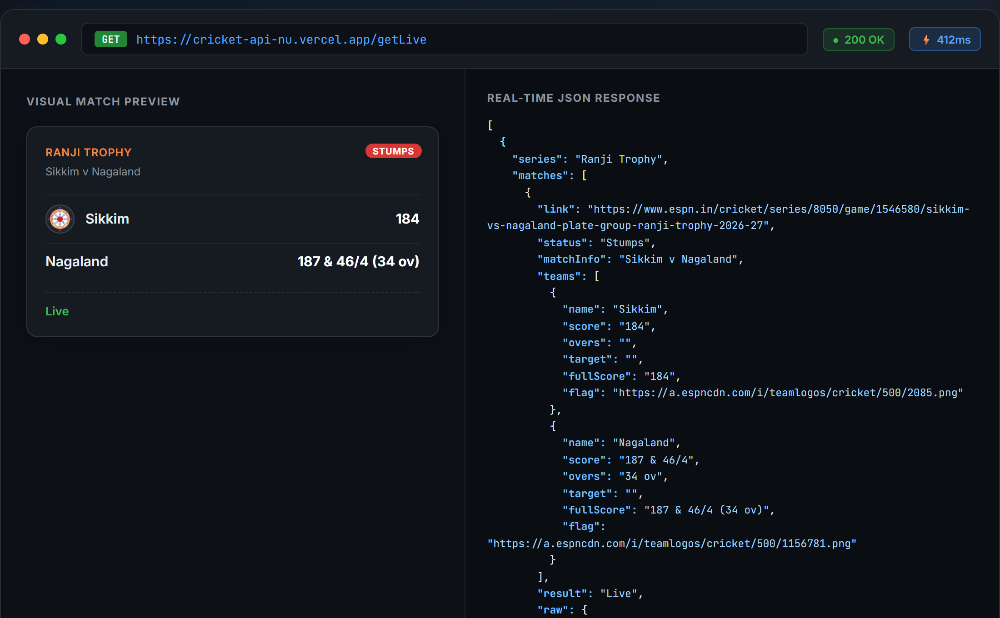

---

## 📱 Frontend Companion: CricGeek UI

This backend powers **[CricGeek](https://github.com/Abhip32/CricGeek)** — a luxury sports web platform inspired by athletic editorial styling (bold high-contrast typography, athletic crimson red `#DC2626` / pure white theme, freely-rendering flags, and zero auto-polling overhead).  
🌐 **Live Web Application**: [https://cric-geek.vercel.app](https://cric-geek.vercel.app)

### 📸 Application Views & Showcase

| Home Dashboard | Live Match Center | Completed Fixtures & Results |
|:---:|:---:|:---:|
| 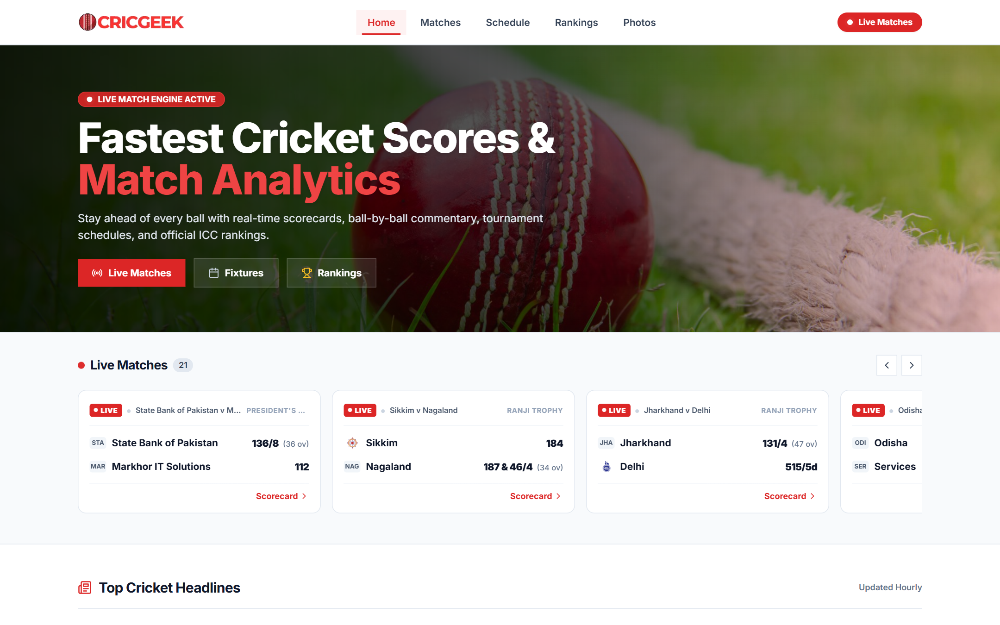 | 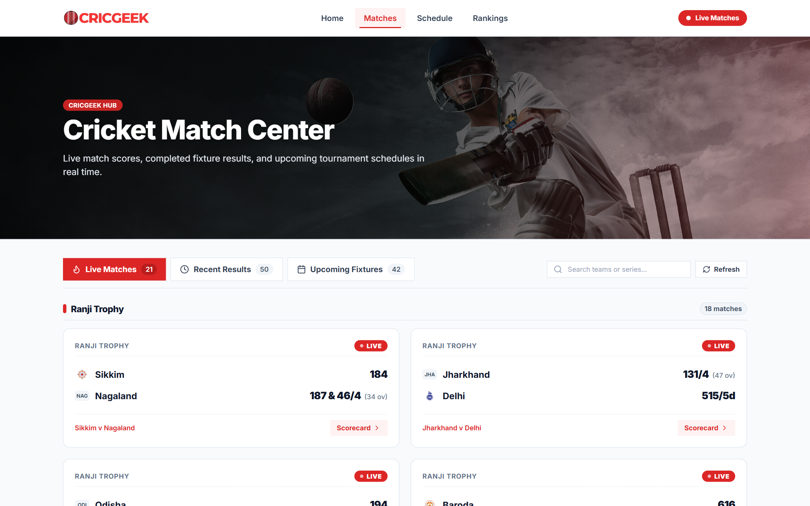 | 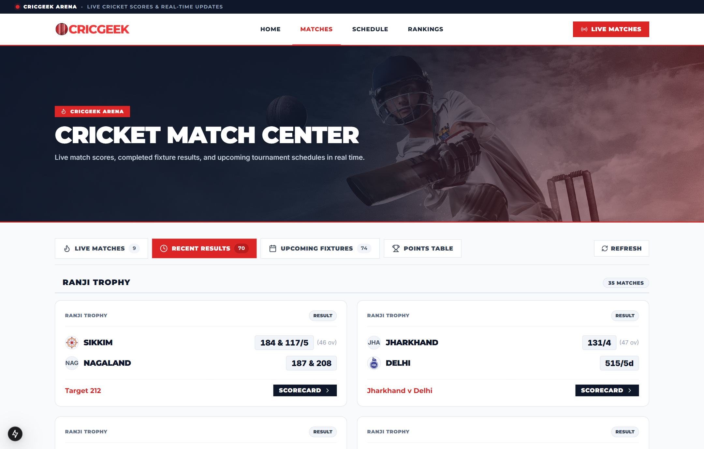 |

| Innings Scorecard & Analytics | MVP & Player Impact Leaderboard | Ball-by-Ball Commentary & Over Timeline |
|:---:|:---:|:---:|
| 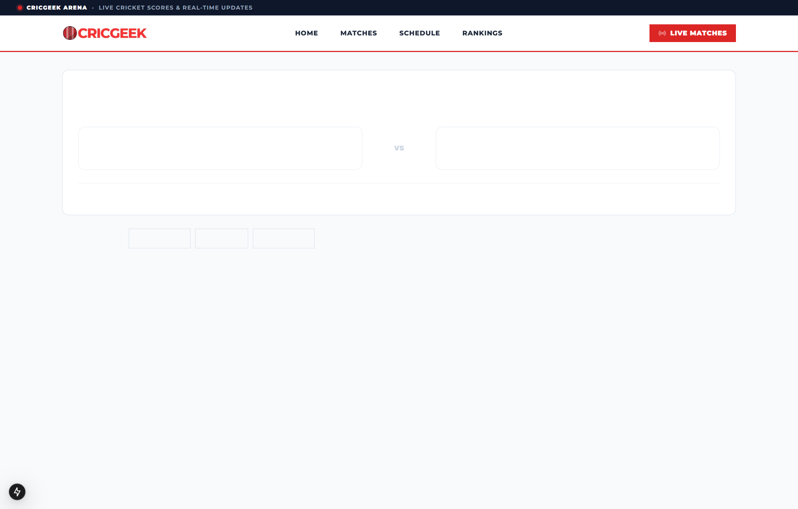 | 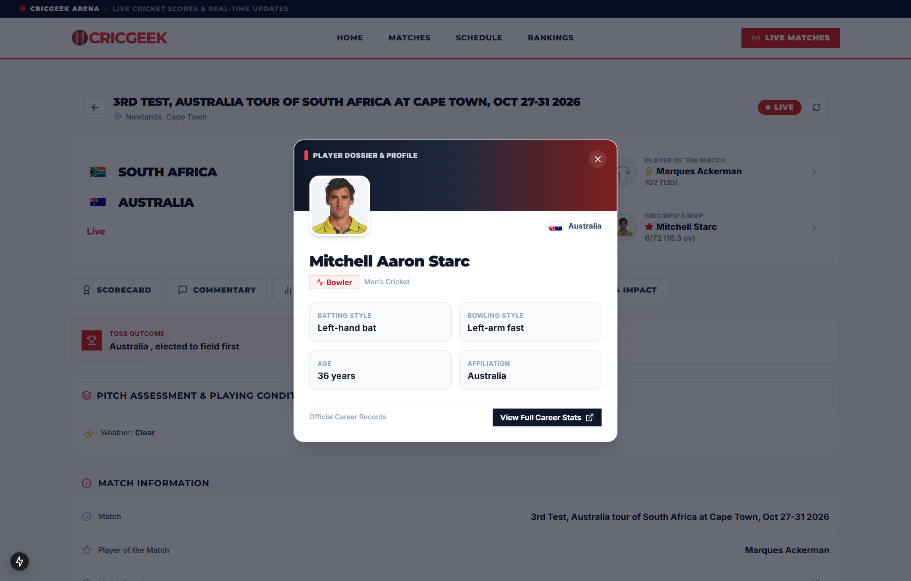 | 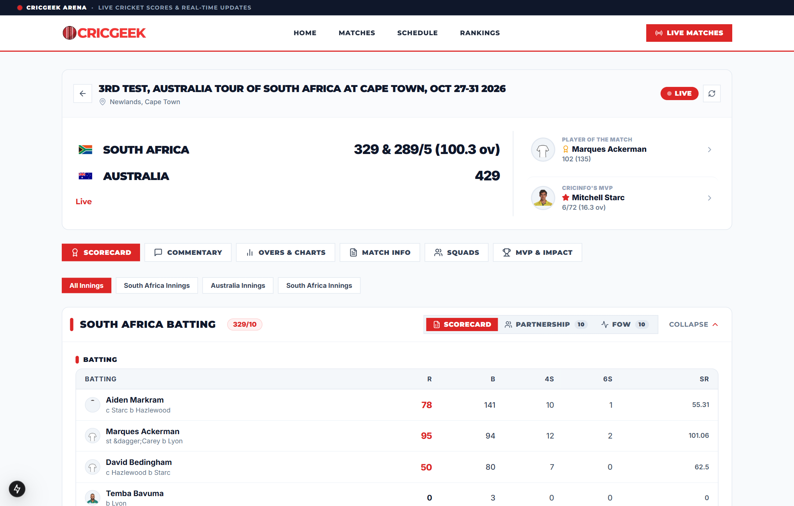 |

| Match Info & Playing XI | Tournament Schedule & Fixtures | Official ICC Leaderboards |
|:---:|:---:|:---:|
| 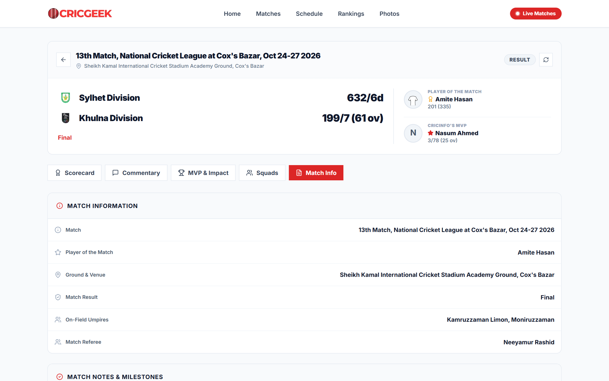 | 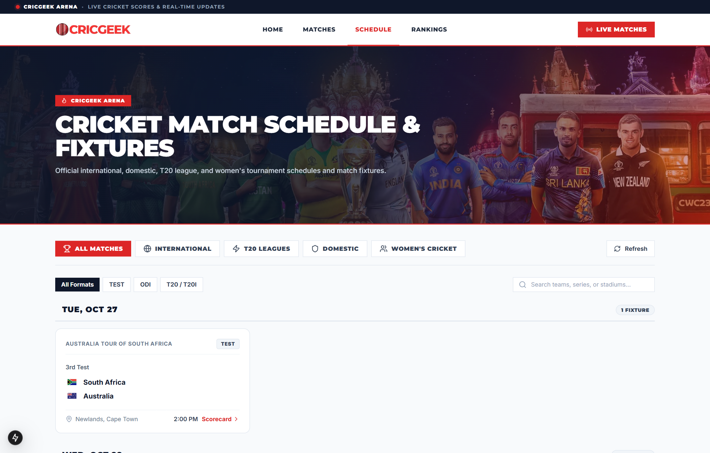 | 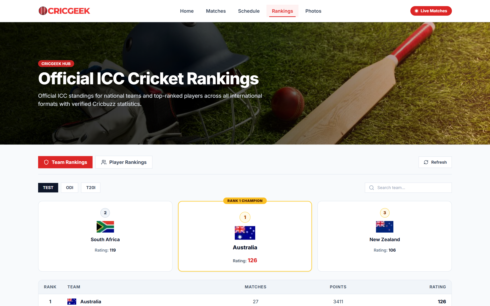 |

| Cricbuzz High-Res Photo Galleries | ICC Player Rankings | Upcoming Fixtures (ESPN Powered) |
|:---:|:---:|:---:|
| 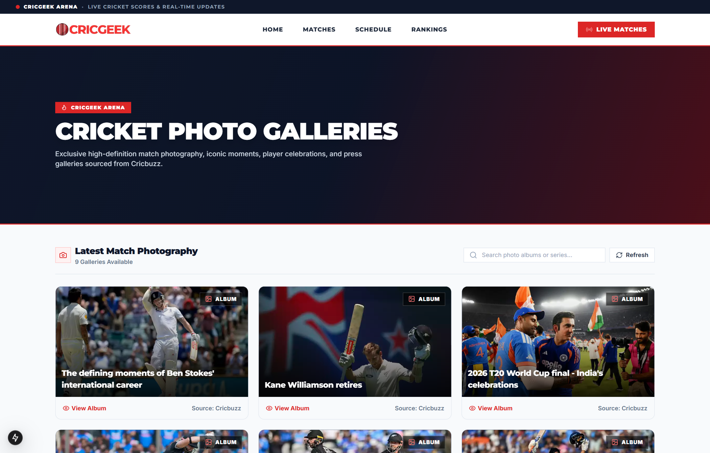 |  | 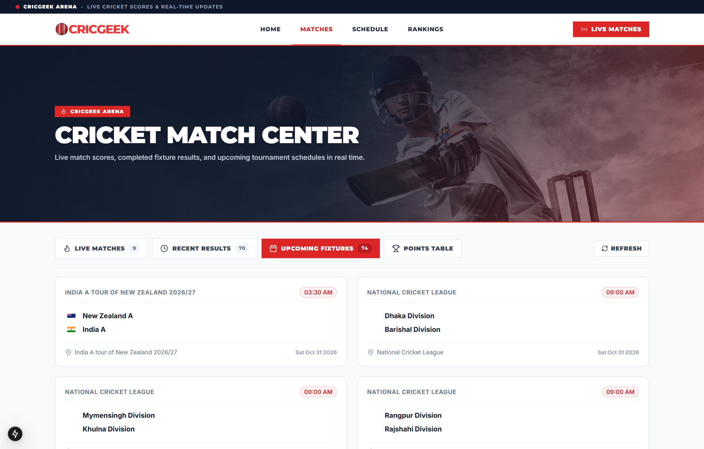 |

---

## ⚡ Key Architecture & Core Capabilities

1. **Player Search & Detailed Player Profiles (`/player/search`, `/player/:id`)**:
   - Ultra-fast player lookup by name with verified athlete IDs and country affiliations.
   - Rich player bio endpoints extracting date of birth, age, batting style, bowling style, playing role, official 500x500 CDN team crest, and verified high-resolution headshots.

2. **Official Tournament Standings & Qualification (`/getStandings`, `/getSeries`)**:
   - Powered by ESPN's official v2 Standings API (`https://site.api.espn.com/apis/v2/sports/cricket/:leagueId/standings`).
   - Returns all participating teams (8+ teams in leagues like WBBL, IPL, BBL, Sheffield Shield) with **Played (P)**, **Won (W)**, **Lost (L)**, **No Result / Tied (NR)**, **Net Run Rate (NRR)**, **Points (PTS)**, and official playoff qualification status (`qualified: 'Y'`).

3. **Match Timeline & Chronological Milestones (`/match/timeline`, `/match/notes`)**:
   - Parses official match notes into chronological events: individual 50s, 100s, partnership stands, session breaks (Lunch, Tea, Stumps, Drinks), tactical markers (new ball taken), and DRS decisions.

4. **Match Leaders & MVPs (`/match/leaders`)**:
   - Innings-by-innings top run scorers and top wicket takers with official high-resolution player headshots, strike rates, economy, and team badges.

5. **Stadium Profile & Live Open-Meteo Weather Radar (`/match/venue`, `/match/weather`)**:
   - Stadium metadata including high-resolution ground photos from Cricinfo CDN, spectator capacity, city, country, pitch grass flag, and match officials with national flags.
   - Real-time live ground weather conditions via Open-Meteo: temperature in both °C and °F, rain probability percentage, humidity %, wind speed, condition name, and rain delay interruption alerts.

6. **Historical Head-to-Head Rivalry & Multi-Match Tour Tracker (`/match/h2h`, `/series/fixtures`)**:
   - Head-to-head lifetime records across formats (matches played, wins per side, draws, ties, no-results) with recent match clash outcomes.
   - Multi-match bilateral tour tracker listing all fixtures chronologically (*1st Test: Concluded • 2nd Test: Live • 3rd Test: Nov 26*).

7. **Real-Time Match Situation & Dynamic Win Predictor Engine (`/match/situation`, `/match/overs`)**:
   - Live Current Run Rate (CRR), Required Run Rate (RRR), target calculations, balls remaining, active striker, and bowler figures.
   - Dynamic cricket win probability engine evaluating completed matches, chases, multi-day test draws/follow-ons, and 1st innings par score models.
   - Grouped over-by-over summaries (`/match/overs`) with runs, wickets, and ball sequences for over chip navigation.

8. **In-Depth Match Analytics & Visual Charts**:
   - **Algorithmic Partnership Crease Hydration (`/match/partnerships`, `/getScorecard`)**: Cross-references playing XI batting orders and Fall of Wickets dismissal records to resolve authentic batsman names, individual runs scored, and balls faced for every wicket stand, eliminating raw empty placeholders.
   - **Fall of Wickets (`/match/fow`)**: Exact over-by-over dismissal timeline with batter scores, dismissal types, and headshots.
   - **DRS Review Tracker (`/match/drs`)**: Review quotas (permitted, remaining, successful, unsuccessful) and live challenge logs.
   - **Manhattan Bar Chart (`/match/manhattan`)**: Over-by-over runs and wickets data ready for frontend visualization.
   - **Worm Progression Chart (`/match/worm`)**: Cumulative run trajectory comparing both innings over by over.

9. **Match Preview, Pitch Report & Playing XI (`/match/preview`, `/match/squads`, `/match/info`, `/match/debuts`)**:
   - Pre-match pitch reports and captain toss quotes extracted from live expert commentary feeds.
   - Playing XI (`starters`), bench/substitutes, captains, wicketkeepers, and match debutants (`/match/debuts`).
   - Stadium venue information and match officials (umpires, referee with nationality flags).

10. **Direct ESPN News Integration with Country Feeds (`/getNews`, `/news`)**:
    - ESPN's official 50-article JSON feed with high-res 900x506 CDN imagery, bylines, published timestamps, and categories.
    - Supports regional feeds via `?country=india`, `?country=australia`, `?country=england`, `?country=pakistan`, `?country=south-africa`, or numeric `feedId`.

11. **100% ESPN API-Powered Live, Recent & Upcoming Fixtures (`/getLive`, `/getRecent`, `/getUpcoming`)**:
    - Direct integration into ESPN's official Scoreboard Header API (`< 100ms`).
    - Immune to Akamai 403 blocks on serverless cloud functions with support for `?league=...`, `?group=international`, and `?region=...` filters.

12. **Ball-by-Ball Commentary Stream with Video Replays (`/getCommentary`)**:
    - Paginated ball-by-ball stream (`&limit=100`, `&page=N`, `&period=N`) with delivery outcomes (`W`, `4`, `6`, `1`, `0`), bowler/batter matchups, HTML-cleaned narratives, and direct video clip replay links (`videoClipUrl`).

13. **Dynamic Team Flags & Multi-Tier In-Memory Cache (`flagService.js`, `cacheService.js`)**:
    - Resolves SVG placeholders into high-resolution badges across 190+ countries and domestic clubs with FlagCDN integration.
    - High-performance LRU memory cache responding in **< 5 milliseconds**.

---

## 🚀 Getting Started

### 1. Install Dependencies
```bash
npm install
```

### 2. Start Server
```bash
# Production mode
npm start

# Development mode with nodemon live reload
npm run dev

# Re-generate documentation preview screenshot
npm run screenshot
```

The API will be available at `http://localhost:8000`.

---

## ☁️ Vercel Serverless Deployment

This project is optimized for deployment as a Vercel Serverless Function:
- **Serverless Chromium**: Automatically switches to [`@sparticuz/chromium-min`](https://github.com/Sparticuz/chromium) and `puppeteer-core` in serverless environments (`VERCEL=1`), fitting cleanly within Vercel's function zip limits without missing shared C++ libraries.
- **Local Fallback**: Automatically discovers local Chrome / Edge installations when running on local development machines.
- **Extended Timeout**: Configured with `maxDuration: 60` and `memory: 1024` in [`vercel.json`](vercel.json) to ensure headless browser launches and page parsing finish comfortably.

---

## 📖 API Documentation & Endpoints

### 1. System & Catalog

#### `GET /`
- **Description**: Returns live API status, version, and an interactive catalog of all available endpoints and parameters.

#### `GET /health`
- **Description**: Lightweight health probe returning `{ status: 'ok', timestamp: '...' }` for uptime monitors.

#### `GET /team-flags`
- **Parameters**: `team` *(optional, e.g. `?team=India` or `?team=NZ`)*
- **Description**: Returns dynamically resolved cricket team logos and flags dictionary.

---

### 2. Player Endpoints

#### `GET /player/search`
- **Cache TTL**: 15 minutes
- **Parameters**:
  - `query` *(required)*: Cricketer search query (e.g. `?query=Kohli` or `?query=Bumrah`).
  - `limit` *(optional, default 10, max 25)*: Number of results.
- **Response**: Array of matching cricketers with player ID, full name, country/team, cricinfo link, and high-resolution headshot CDN URL (`https://a.espncdn.com/i/headshots/cricket/players/full/:id.png`).

#### `GET /player/:id` or `GET /getPlayer`
- **Cache TTL**: 1 hour
- **Parameters**:
  - `id` *(required in path `/player/:id` or query `?id=253802`)*: Numeric athlete ID.
- **Response**: Complete athlete profile including `dateOfBirth`, `age`, `gender`, `position` (role), `battingStyle`, `bowlingStyle`, national team details with official hex color and 500x500 CDN crest, and verified headshot image.

#### `GET /search` (Universal Search)
- **Cache TTL**: 10 minutes
- **Parameters**:
  - `query` *(required, e.g. `?query=Australia` or `?query=Mumbai+Indians`)*
  - `type` *(optional: `player`, `team`, `league`, `series`, `article`, `clips`)*
  - `limit` *(optional, default 10)*
- **Response**: Structured search results grouped by category across cricketers, franchise & national teams, tournament series, news stories, and video replays.

---

### 3. Tournaments, Series & Standings

#### `GET /getSeries` or `GET /series`, `GET /getTournaments`
- **Cache TTL**: 10 minutes
- **Parameters**: `refresh=true` *(optional)*
- **Response**: List of all currently active tournaments and series with `id` (`leagueId`), `name`, `slug`, `isTournament`, `season`, `eventsCount`, and active match snapshots.

#### `GET /getStandings` or `GET /standings`, `GET /series/:leagueId/standings`
- **Cache TTL**: 5 minutes
- **Parameters**:
  - `leagueId` *(required, e.g. `?leagueId=8043` for Sheffield Shield or `?leagueId=21284` for WBBL)*
  - `refresh=true` *(optional)*
- **Response**: Official tournament points table powered by ESPN's v2 Standings API. Returns all teams with `rank`, `team` (name, logo, abbreviation), `played`, `won`, `lost`, `tied`, `noResult`, `points`, `netrr`, `qualified` (boolean indicator for playoff qualification), and cumulative run records (`runsFor`, `runsAgainst`).

#### `GET /getSeriesTeams` or `GET /series/:leagueId/teams`
- **Cache TTL**: 15 minutes
- **Parameters**:
  - `leagueId` *(required, e.g. `?leagueId=8043`)*
- **Response**: All participating teams in the specified tournament with names, abbreviations, location, and official logos.

#### `GET /series/fixtures` or `GET /getSeriesFixtures`, `GET /series/:leagueId/fixtures`
- **Cache TTL**: 3 minutes
- **Parameters**:
  - `leagueId` *(required, e.g. `?leagueId=21284`)*
  - `refresh=true` *(optional)*
- **Response**: Multi-match tour schedule listing all matches chronologically with match numbers, teams, live/final scores, match states (`pre`, `in`, `post`), venues, and status text.

---

### 4. Matches, Ticker & Fixtures

#### `GET /getTicker` or `GET /match/ticker`
- **Cache TTL**: 30 seconds
- **Parameters**: `refresh=true` *(optional)*
- **Response**: Real-time scrolling ticker feed with team crests, live scores, overs, status badges, and match links for the top navigation bar.

#### `GET /getLive`
- **Cache TTL**: 45 seconds
- **Parameters**:
  - `league` *(optional, filter by tournament ID, e.g. `?league=8048`)*
  - `group` *(optional, e.g. `?group=international`)*
  - `region` *(optional, e.g. `?region=in`)*
  - `refresh=true` *(optional)*
- **Response**: Array of current live matches with scores, overs, run rates, targets, series, match status, and dynamic team flags.

#### `GET /getRecent`
- **Cache TTL**: 5 minutes
- **Parameters**:
  - `league`, `group`, `region` *(optional)*
  - `refresh=true` *(optional)*
- **Response**: Recently completed matches grouped by series with final results, scores, and dynamic team flags.

#### `GET /getUpcoming`
- **Cache TTL**: 10 minutes
- **Parameters**:
  - `date` *(optional, YYYYMMDD format, e.g. `?date=20261101`)*
  - `category` *(optional: `international`, `domestic`, `league`)*
  - `format` *(optional: `TEST`, `ODI`, `T20`)*
  - `league`, `group`, `region` *(optional)*
  - `refresh=true` *(optional)*
- **Response**: Upcoming scheduled fixtures with full team details, flags, series titles, venue information, start timestamps, and match formats.

#### `GET /getSchedule` or `GET /getschdule`
- **Cache TTL**: 10 minutes
- **Parameters**: `refresh=true` *(optional)*
- **Response**: Comprehensive tournament schedules, series fixtures, venue information, and match timings.

---

### 5. Detailed Scorecard & In-Match Analytics

#### `GET /getScorecard` or `GET /scorecard`
- **Cache TTL**: 45 seconds (live) / 30 minutes (completed)
- **Parameters**:
  - `url` *(optional, e.g. `?url=https://www.espncricinfo.com/series/...`)*. Defaults to the latest active match if omitted.
  - `leagueId` & `eventId` *(optional, direct IDs, e.g. `?leagueId=24756&eventId=1553295`)*
  - `refresh=true` *(optional)*
- **Response**: Full match scorecard including batting tables (R, B, 4s, 6s, SR, dismissal), bowling tables (O, M, R, W, ECON), fall of wickets, wicket-by-wicket partnerships, DRS reviews, Playing XI squads, toss, venue, officials, leaders, and match status.

#### `GET /match/situation` or `GET /getSituation`
- **Cache TTL**: 30 seconds
- **Parameters**: `leagueId` & `eventId` *(or `url`)*
- **Response**: Real-time match situation including live Current Run Rate (CRR), Required Run Rate (RRR), target calculations, balls remaining, last 5 overs runs/wickets, active striker, bowler figures, and dynamic win probability predictor.

#### `GET /match/overs` or `GET /getOvers`
- **Cache TTL**: 30 seconds
- **Parameters**: `leagueId` & `eventId` *(or `url`)*
- **Response**: Grouped over-by-over summaries with over number, period (innings), bowler name, runs conceded, wickets taken, and individual ball outcome chips (`[1, 4, ., W, 2, 6]`) for over navigation.

#### `GET /match/timeline` or `GET /getTimeline`, `GET /match/notes`
- **Cache TTL**: 45 seconds (live) / 30 minutes (completed)
- **Parameters**: `leagueId` & `eventId` *(or `url`)*
- **Response**: Chronological match notes categorized into `milestones` (individual 50s/100s), `partnerships`, `sessions` (Lunch, Tea, Stumps, Drinks breaks), and `drsReviews` with over and innings stamps.

#### `GET /match/leaders` or `GET /getLeaders`
- **Cache TTL**: 45 seconds (live) / 30 minutes (completed)
- **Parameters**: `leagueId` & `eventId` *(or `url`)*
- **Response**: Top batters and top bowlers with official HD headshots, team badges, runs, wickets, strike rate, and economy.

#### `GET /match/venue` or `GET /getVenue`
- **Cache TTL**: 15 minutes
- **Parameters**: `leagueId` & `eventId` *(or `url`)*
- **Response**: Stadium profile: name, city, country, spectator capacity, pitch grass surface, official high-resolution ground photo from Cricinfo CDN, and match officials (umpires, TV umpire, match referee with national flags).

#### `GET /match/weather` or `GET /getWeather`
- **Cache TTL**: 15 minutes
- **Parameters**: `leagueId` & `eventId` *(or `url`)*
- **Response**: Real-time ground weather radar via Open-Meteo: temperature in °C and °F, rain probability percentage, humidity %, wind speed (km/h), condition name, and rain delay warning alert (`rainInterruptionAlert`).

#### `GET /match/debuts` or `GET /getDebuts`
- **Cache TTL**: 15 minutes
- **Parameters**: `leagueId` & `eventId` *(or `url`)*
- **Response**: Players making their match or tournament debut in this encounter with player IDs, names, headshots, and team details.

#### `GET /match/h2h` or `GET /getH2H`, `GET /getH2h`
- **Cache TTL**: 1 hour
- **Parameters**: `leagueId` & `eventId` *(or `url`)*
- **Response**: Lifetime head-to-head records between competing sides: total matches played, team 1 wins, team 2 wins, draws, ties, no-results, win split percentages, and recent clash encounter outcomes.

#### `GET /match/partnerships` or `GET /getPartnerships`
- **Cache TTL**: 45 seconds (live) / 30 minutes (completed)
- **Parameters**: `leagueId` & `eventId` *(or `url`)*
- **Response**: Complete wicket-by-wicket partnership analysis for every innings with total runs, balls, duration in overs, partnership run rate, start/end scores, and individual batsman contributions with headshots.

#### `GET /match/fow` or `GET /getFow`
- **Cache TTL**: 45 seconds (live) / 30 minutes (completed)
- **Parameters**: `leagueId` & `eventId` *(or `url`)*
- **Response**: Fall of Wickets (FOW) timeline for each innings with exact wicket over, team score, batsman runs, balls faced, dismissal type, and player headshot image.

#### `GET /match/drs` or `GET /getDrs`
- **Cache TTL**: 45 seconds (live) / 30 minutes (completed)
- **Parameters**: `leagueId` & `eventId` *(or `url`)*
- **Response**: Review statistics per team and innings (`reviewsPermitted`, `remaining`, `successful`, `unsuccessful`) along with the complete historical log of all DRS challenges.

#### `GET /match/squads` or `GET /getSquads`
- **Cache TTL**: 15 minutes
- **Parameters**: `leagueId` & `eventId` *(or `url`)*
- **Response**: Playing XI (`starters`), bench/substitutes, captains, wicketkeepers, and match debutants with verified headshots.

#### `GET /match/info` or `GET /getMatchInfo`
- **Cache TTL**: 15 minutes
- **Parameters**: `leagueId` & `eventId` *(or `url`)*
- **Response**: Match details including Toss decision, match number, match days, session timings, stadium venue (city, country, capacity, surface type), and match officials (umpires, referee with flags).

#### `GET /match/preview` or `GET /getMatchPreview`
- **Cache TTL**: 30 minutes
- **Parameters**: `leagueId` & `eventId` *(or `url`)*
- **Response**: On-field Pitch Report, captain toss quotes, and tactical team setup narrative from expert commentators.

#### `GET /match/manhattan` or `GET /getManhattan`
- **Cache TTL**: 45 seconds (live) / 30 minutes (completed)
- **Parameters**: `leagueId` & `eventId` *(or `url`)*
- **Response**: Over-by-over runs scored, wickets fallen, bowler names, and cumulative score for each innings ready to plot a Manhattan bar chart.

#### `GET /match/worm` or `GET /getWorm`
- **Cache TTL**: 45 seconds (live) / 30 minutes (completed)
- **Parameters**: `leagueId` & `eventId` *(or `url`)*
- **Response**: Cumulative score progression curves across overs comparing both innings for plotting a Worm chart.

#### `GET /getCommentary` or `GET /commentary`
- **Cache TTL**: 30 seconds
- **Parameters**:
  - `leagueId` & `eventId` *(or `url`)*
  - `limit` *(optional, 1-300, default 100)*: Number of balls to return per page.
  - `page` *(optional, default 1)*: Page number for infinite scroll.
  - `period` *(optional, 1, 2, 3, 4)*: Filter by innings.
- **Response**: Ball-by-ball commentary stream with ball outcomes (`W`, `4`, `6`, `1`, `0`), bowler and batter live stats, dismissal notes, pre-ball narrative, and direct video clip replay links (`videoClipUrl`).

---

### 6. News, Media & Rankings

#### `GET /getNews` or `GET /news`
- **Cache TTL**: 10 minutes
- **Parameters**:
  - `country` *(optional: `india`, `australia`, `england`, `pakistan`, `south-africa`)*
  - `feedId` *(optional numeric feed ID: `0`=global, `6`=india, `2`=australia, `1`=england, `7`=pakistan, `3`=south africa)*
  - `leagueId` *(optional, e.g. `?leagueId=8048` for tournament news)*
  - `refresh=true` *(optional)*
- **Response**: Latest 50 cricket articles directly from ESPN with titles, descriptions, authors, publication timestamps, high-res 900x506 images, categories, and article links.

#### `GET /getPhotos`
- **Cache TTL**: 15 minutes
- **Parameters**: `id` *(optional album ID, e.g. `?id=2405`)*
- **Response**: High-resolution cricket photo albums from Cricbuzz (`750x422`) with captions and photo credits.

#### `GET /rankings/icc-team-ranking` or `GET /getTeamRankings`
- **Cache TTL**: 1 hour
- **Response**: Official Men's and Women's ICC rankings for Test, ODI, and T20 teams with ratings, points, and dynamic logos.

#### `GET /rankings/icc-player-ranking` or `GET /getBattingRankings`, `/getBowlingRankings`, `/getAllRounderRankings`
- **Cache TTL**: 1 hour
- **Response**: Official ICC player rankings across Batting, Bowling, and All-rounders in Test, ODI, and T20 formats with player names, ratings, and nationalities.

---

## 📁 Project Structure

```
Cricket-Api/
├── assets/                       # High-resolution screenshots & preview assets
├── controller/
│   ├── MatchDataController.js    # Live, Recent, Upcoming (ESPN API), Schedule & Ticker
│   ├── newsController.js         # Direct ESPN News API & Country-specific feeds
│   ├── photoController.js        # Cricbuzz photo galleries & albums
│   ├── playerController.js       # Player profiles, search & universal search
│   ├── rankingController.js      # ICC team & player rankings
│   ├── scoreCardController.js    # Scorecards, Commentary, Timeline, Leaders, Venue, Weather, Debuts, H2H, Analytics
│   └── seriesController.js       # Tournaments, series, v2 standings (points tables) & tour fixtures
├── routes/
│   ├── MatchDataRoute.js         # /getLive, /getRecent, /getUpcoming, /getSchedule, /getTicker
│   ├── newsRoute.js              # /getNews, /news
│   ├── photoRoute.js             # /getPhotos
│   ├── playerRoute.js            # /player/search, /player/:id, /search
│   ├── rankingRoutes.js          # /rankings/*
│   ├── ScoreCardRoute.js         # /getScorecard, /match/*, /getCommentary
│   └── seriesRoute.js            # /getSeries, /getStandings, /series/*, /series/fixtures
├── services/
│   ├── browserService.js         # Puppeteer lifecycle & ad/media blocker
│   ├── cacheService.js           # Multi-tier TTL cache with LRU eviction
│   └── flagService.js            # Dynamic team flag learning & resolution
├── scripts/
│   └── generate_screenshot.js    # Generates preview.png asset
├── index.js                      # Main Express server & API catalog
├── vercel.json                   # Serverless deployment configuration
└── package.json                  # Dependencies & scripts
```

---

## 👨‍💻 Author

Created & Maintained by **[Abhip32](https://github.com/Abhip32)**
